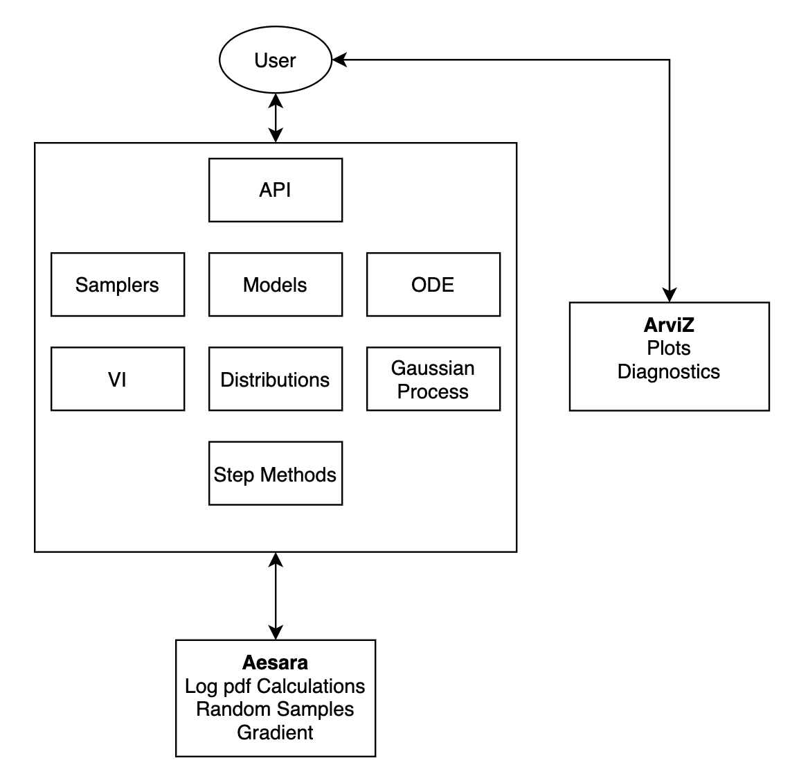

# Architecture
This document describes the high-level architecture of PyMC.

# Bird's Eye View
[comment]: <> (https://drive.google.com/file/d/1lfEzokkNUJr_JIeSDQfha5a57pokz0qI)

Lets you define probabilistic graphs or models that can be easily used to compute log probabilities for posterior
inference or to draw random samples for prior and posterior prediction.

PyMC includes a few inference techniques, in particular:
* Markov chain Monte Carlo
* Variational Inference
* Sequential Monte Carlo

It also contains numerous others pieces of functionality such as GraphviZ model visualization tools
as well as various mathematical helper functions.

The most central pieces functionality of PyMC are shown visually below, as well as their
relation to other major packages. Not all modules are shown, either because
they are smaller or self explanatory in scope, or they're pending
deprecation

## Functionality not in PyMC
It is easier to start with functionality that is not present in PyMC but
rather deferred to outside libraries. If seeking to understand any
of the topics below refer to that specific library

### PyTensor
* Gradient computation
* Random number generation
* Low level tensor operation definition
* Low level operation graphs

### ArviZ
* Plotting e.g. Trace plots, rank plots, posterior plots
* MCMC sampling diagnostics e.g. Rhat, Effective Sample Size.
* Model comparison, particularly efficient leave-one-out cross-validation approximation
* Data structures for Bayesian inference data storage and manipulation

### SciPy and better-optimize
* Numerical optimization for {func}`pymc.find_MAP`, through `scipy.optimize` wrapped by
  `better-optimize` (fused objectives, progress bars, early stopping)


# Modules
The codebase of PyMC is split among single Python file modules at the root
level, as well as directories with Python code for logical groups of functionality.
Admittedly the split between single `.py` module or directory is not defined by a strict
criteria but tends to occur when single `.py` files would be "too big".
The following model illustrates how the core pieces fit together. The sections
below describe the major packages and modules.

```python
import pymc as pm

with pm.Model() as model:
    theta = pm.Beta("theta", alpha=1, beta=2)
    y = pm.Binomial("y", n=2, p=theta, observed=[1, 2])
    idata = pm.sample()
```

## {mod}`pymc.model`
Contains primitives related to model definition and methods used to evaluate models.
Core model implementation lives in `pymc/model/core.py`, while graph and transform
functionality is organized in the other modules under `pymc/model/`.

`Model` provides the context manager used by `with pm.Model() as model`. The package
also implements deterministic variables, potentials, model graph construction, and
transformations.

## `pymc/distributions/`
Contains distribution definitions and supporting logic, including:

* `distribution.py`: Base classes and shared distribution behavior.
* `continuous.py`, `discrete.py`, and `multivariate.py`: Distribution definitions.
* `dist_math.py` and `shape_utils.py`: Mathematical and shape utilities.

## `pymc/logprob/`
Implements log-probability inference and graph rewrites, building on PyTensor.

## `pymc/sampling/`
Sampling functionality is organized as a package rather than a single module:

* `mcmc.py`: Posterior MCMC sampling and NUTS initialization.
* `forward.py`: Prior and posterior predictive sampling and drawing.
* `jax.py`: Interfaces to external JAX-based samplers.
* `population.py`: Population-based sampling.

## `pymc/step_methods/`
Contains step methods for MCMC algorithms, including the HMC/NUTS family, Metropolis,
and Slice sampling.

## Other inference and storage packages
Other major areas of the codebase include `pymc/variational/` for variational inference,
`pymc/smc/` for sequential Monte Carlo, `pymc/ode/` for ODE-based models,
`pymc/dims/` for named-dimension functionality, and `pymc/backends/` for sample
storage backends.

## `tests/`
Tests are organized by functionality, generally mirroring the corresponding package
modules. Files named `test_*.py` contain tests; other files provide shared test support.
