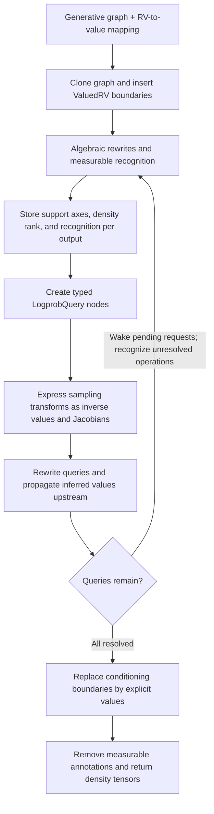
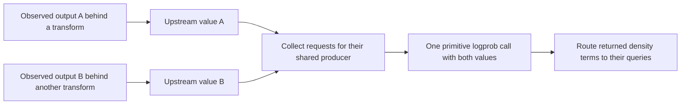

# How logprob inference works

Logprob inference compiles a generative graph and a collection of observations
into a graph of density expressions. The observations can belong to primitive
random variables or to expressions built from them.

The entry point for a collection of observations is `conditional_logp` in
`pymc/logprob/basic.py`. It returns one tensor for each supplied value; summing
all entries of all returned tensors gives the joint logprob.

## The inference graph

`ValuedRV(rv, value)` records an observation. Other expressions that consume
this boundary can treat it as known. A `LogprobQuery` retains the pair so its
source distribution is still available when deriving its density.

An observation whose density layout is unresolved stays in the queue as a
`ValuedRV` output. It becomes a typed `LogprobQuery` only when its rank and
required support axes are known. Its declared observation path already counts
when deciding whether another request shares a producer. Initial custom
density rewrites currently require all initial query layouts to be resolved.

For example, observing `exp(x) = y` creates the upstream binding
`x = log(y)`. A separate observation of `z ~ Normal(x, 1)` must use `log(y)` as
its mean. This is why a query rule imports inferred bindings into the shared
graph, rather than merely returning an isolated formula.

## Metadata is an analysis result

Recognized tensor operations carry metadata for every output:

| Field | Meaning |
| --- | --- |
| `supp_axes` | Axes consumed by an event density. `()` denotes scalar support; `None` denotes an unknown layout. |
| `logp_ndims` | Rank of the density tensor. It is separate from support axes because a concatenation can group several event factors. |
| `measurable_outputs` | Per-output recognition state. |
| `transform`, `measured_input` | The selected transform and its measured input slot, when applicable. |

The annotations form an immutable `DensityMetadata` object, passed explicitly
to the constructor of an alternative measurable operation together with its
native tensor operation. Recognition does not mutate an operation shared by
other nodes or graphs. Its native operation is restored during cleanup.

A multi-output operation remains native until every stochastic output has a
resolved density layout. This prevents one ready output from freezing an
unresolved sibling's metadata. A typed query can still select a native IfElse
branch structurally, without recognizing the whole operation first.

The alternative operation owns node construction: it lets the native
operation normalize tensor types and retains its declared density metadata.
Cloning and parameter substitution preserve the recognition decision. Changing
native parameters, such as reduction axes, produces a native operation that
must be recognized separately. Native constructors cannot silently drop
annotations while cloning a measurable Op.

`support_axes` and `density_ndim` read stored metadata. Local inference rules
propagate it when an expression is first recognized. A transpose, for example,
permutes its input's support axes; it does
not derive the input's density to discover them. This allows compositions such
as a censored variable followed by a transpose.

`QueryQueue` schedules unresolved density requests. Tensor requests propagate
observations before primitive producers emit their grouped density terms.
Requests that lack an observation or a recognized input wait; new bindings
can unlock previously unresolved operations. Accepted measurable operations
are skipped by recognition and their metadata is never invalidated.

Recognition follows source paths leading to observations. Already emitted
density arithmetic and observation-value expressions are excluded, even if
they still refer to a parameter whose value has not arrived yet.

If all inputs of a recognized expression acquire values, the engine publishes
that expression's known value through another `ValuedRV` boundary. Its density
interpretation remains attached to the original Op. Downstream expressions
can then use the known value as a parameter.

These fields describe density layout and recognition. They do not encode a
general reference measure or establish independence between arbitrary factors.

## Query rules and primitive formulas

`rewrite_logprob_query` dispatches on the generating operation. Tensor rules
invert observations, add Jacobians, split or combine values, or introduce
separate conditional branches.

Primitive producers use `_logprob`. Before calling it, the engine collects
queries for the producer's outputs in output order. It waits if another
requested output is still behind a transformation. Parameters and values
passed to `_logprob` have their conditioning boundaries replaced by explicit
values.

## Composition cases

### Join and Split

An observed Join supplies simultaneous values to its components. Those
bindings may unlock transformations or determine parameters of other
components. Split gathers the requested output values before reconstructing
the input observation. Partial event observations require a marginalization
rule; support metadata alone does not provide one.

### IfElse and indexed mixtures

A known selector chooses a conditional graph. Each branch gets its own value
bindings for the connected inference scope. If inverting the selected branch
determines a parameter of another density, that density is included in the
same scope. Scalar conditionals use lazy branch selection so an inactive
branch does not evaluate invalid parameters.

The scope includes observation roots whose density layout is still pending.
When branch-local bindings determine those layouts, inference resolves that
branch before combining its density outputs with the other branches.

### Alternative inverses

For supported scalar-support transforms such as absolute value, the inverse
has alternative values. Their densities are added in probability space with
`logaddexp`. The engine derives one density template and substitutes each
inverse value into that template. Its distribution parameters retain their
identity in the surrounding graph, so later bindings still condition them.

This rule does not apply to joint observations sharing the same source,
coupled sources within one request, or multivariate sign combinations. Those
cases require a joint inverse rule and remain explicitly unsupported.

## Sampling transforms and cleanup

`TransformValuesRewrite` expresses a sampling transform with its backward
value expression and ordinary Jacobian arithmetic. These expressions remain
in the inference graph, where upstream bindings can update their parameters.

Successful inference removes all `LogprobQuery` nodes. It then substitutes the
explicit values at conditioning boundaries and removes measurable tensor
annotations. A stalled inference raises an error instead of compiling an
unresolved query or silently treating shared randomness as independent.
